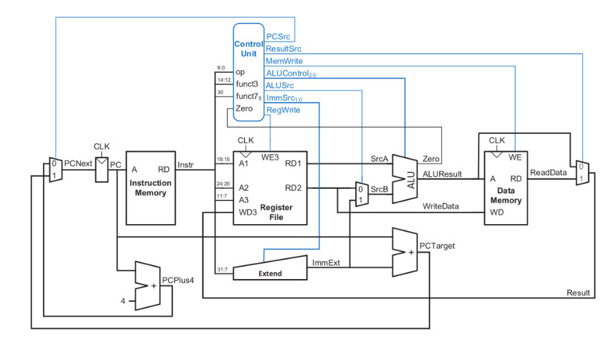

# processador-em-RISC-V
Esse repositório tem como objetivo a criação de um processador usando alguma HDL (a escolhida foi Verilog).

O atual processador pode realizar funções do tipo R, I, J, e B. Que são as funções mais necessárias para o funcionamento correto do meu processador.

Todo o esquemático foi baseado no processadpr de ciclo único do livro [Digital Design and Computer Architecture](https://www.amazon.com.br/Digital-Design-Computer-Architecture-Harris/dp/0123704979), no qual a imagem está abaixo:

